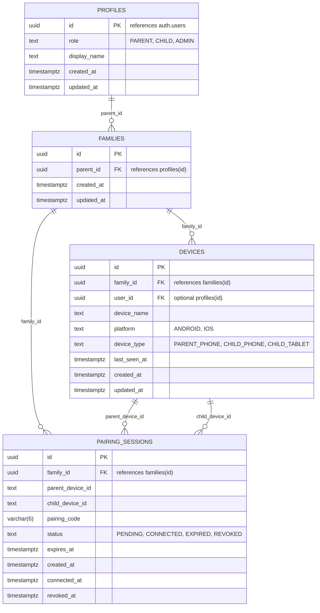

# NIQOB - Phase 3 Supabase Backend Integration Guide

## Overview

This document provides complete instructions for setting up the cloud backend for **NIQOB** using [Supabase](https://supabase.com). 

The backend supports multi-platform child digital safety and management (Android Parent & Child apps today, iOS in future phases) using:
- **Supabase Authentication**: Parent account registration, sign in, session persistence.
- **PostgreSQL Database**: UUID primary keys, relational schema (`profiles`, `families`, `devices`, `pairing_sessions`).
- **Row Level Security (RLS)**: Strict tenant isolation ensuring parents access only their own family, children access only their paired devices, and unauthenticated public access is prevented.
- **Atomic Stored Procedures (RPC)**: Race-condition-free pairing code creation, pairing validation, device connection, and heartbeats.

---

## 1. Supabase Project Creation

1. Navigate to [Supabase Dashboard](https://database.new) and sign in or create an account.
2. Click **New Project**.
3. Fill in:
   - **Name**: `niqob-production` (or `niqob-dev`)
   - **Database Password**: Generate and securely store a strong password.
   - **Region**: Choose the region closest to your primary user base.
   - **Pricing Plan**: Free tier or Pro.
4. Click **Create new project** and wait ~1-2 minutes for the database to provision.

---

## 2. Required Configuration & Credentials

### Where to Find Your Credentials

In your Supabase project dashboard:
1. Go to **Project Settings** (gear icon in left sidebar) -> **API**.
2. Under **Project URL**:
   - Copy the URL (e.g. `https://xyzcompany.supabase.co`). This is your `SUPABASE_URL`.
3. Under **Project API keys**:
   - Copy the key labeled **`anon` `public`** (or `publishable`). This is your `SUPABASE_ANON_KEY`.
   - ⚠️ **CRITICAL SECURITY RULE**: **NEVER** use the `service_role` (secret) key in the Android app. The service role key bypasses Row Level Security and must remain server-side only.

### Setting Local Credentials in the Android Project

In the root of the NIQOB Android project, open or create `local.properties` (which is in `.gitignore` and never committed to source control):

```properties
## NIQOB Local Environment Configuration
sdk.dir=/Users/your-username/Library/Android/sdk

# -------------------------------------------------------------
# SUPABASE CREDENTIALS (REQUIRED FOR LIVE BACKEND CONNECTIVITY)
# -------------------------------------------------------------
SUPABASE_URL=https://your-project-id.supabase.co
SUPABASE_ANON_KEY=eyJhbGciOiJIUzI1NiIsInR5cCI6IkpXVCJ9...
```

At build time, Gradle reads these properties via `buildConfigField` in `app/build.gradle.kts`:
- `BuildConfig.SUPABASE_URL`
- `BuildConfig.SUPABASE_ANON_KEY`

If these properties are not provided or remain empty, the app will **NOT** invent dummy data. Instead, `NiqobSupabaseClient.isConfigured` returns `false`, and UI flows will cleanly display that configuration credentials are required.

---

## 3. Database Schema & Migration Instructions

### Applying the Migration

1. Open your Supabase Dashboard.
2. In the left navigation, click on **SQL Editor**.
3. Click **New query**.
4. Paste the entire content of [`supabase/schema.sql`](../supabase/schema.sql).
5. Click **Run** (or `Cmd + Enter`).

### Schema Structure



---

## 4. Row Level Security (RLS) Policies

All tables have Row Level Security enabled (`ALTER TABLE ... ENABLE ROW LEVEL SECURITY`). There are no broad `authenticated -> true` policies.

### Detailed Policy Matrix

| Table | Policy Name | Permitted Operation | Target Role | Description |
|---|---|---|---|---|
| `profiles` | `profiles_select_own` | `SELECT` | Authenticated | Parents can view only their own user profile (`auth.uid() = id`). |
| `profiles` | `profiles_update_own` | `UPDATE` | Authenticated | Parents can update only their own profile display name / settings. |
| `families` | `families_select_parent` | `SELECT` | Authenticated | Parents can view only families they own (`parent_id = auth.uid()`). |
| `families` | `families_insert_parent` | `INSERT` | Authenticated | Parents can create a family where `parent_id = auth.uid()`. |
| `devices` | `devices_select_family` | `SELECT` | Authenticated | Parents can view devices belonging to families they own. |
| `devices` | `devices_insert_family` | `INSERT` | Authenticated | Parents can register devices into their own family. |
| `devices` | `devices_update_family` | `UPDATE` | Authenticated | Parents can rename or update devices belonging to their family. |
| `pairing_sessions` | `pairing_select_parent` | `SELECT` | Authenticated | Parents can view pairing sessions belonging to their family. |
| `pairing_sessions` | `pairing_update_parent` | `UPDATE` | Authenticated | Parents can update (e.g. revoke) pairing sessions belonging to their family. |

### Public RPC Functions (`SECURITY DEFINER`)
For child device pairing where the child does not yet possess a parent auth session:
- **`pair_child_device(p_code, p_child_device_id, p_child_device_name, p_platform)`**: Validates the 6-digit code, verifies `status = 'PENDING'`, verifies `now() < expires_at`, registers the child device into `devices`, and sets session status to `CONNECTED`.
- **`update_device_heartbeat(p_device_id)`**: Updates `last_seen_at = now()` for an active device without exposing access to edit other device properties.

---

## 5. Pairing Flow Architecture

```
Parent Device                               Supabase Server                               Child Device
    │                                              │                                           │
    ├────────── 1. Create Pairing Code ───────────>│                                           │
    │           (POST rpc/create_pairing_session)  │                                           │
    │                                              ├─ Generates 6-digit code                   │
    │                                              ├─ Sets expires_at = now() + 10 min         │
    │                                              ├─ Sets status = 'PENDING'                  │
    │<───────── 2. Returns Code (e.g. 842109) ─────┤                                           │
    │                                              │                                           │
    │ [Parent displays 6-digit code on screen]     │                                           │
    │                                              │                                           │
    │                                              │<─── 3. Enter Code "842109" ───────────────┤
    │                                              │     (POST rpc/pair_child_device)          │
    │                                              ├─ Validates code & expiration (< 10 min)   │
    │                                              ├─ Verifies status == PENDING               │
    │                                              ├─ Inserts child record into `devices`      │
    │                                              ├─ Updates status = 'CONNECTED'             │
    │                                              │                                           │
    │<───────── 4. Realtime / Polling Update ──────┼──────── 5. Connection Success ───────────>│
    │           (Status -> CONNECTED)              │                                           │
    │                                              │                                           │
    │ [Parent Dashboard shows Connected Device]    │           [Child Home shows Parent Synced]│
```

---

## 6. Device Heartbeat & Connectivity Thresholds

Child devices send a periodic heartbeat via `updateHeartbeatUseCase(deviceId)` calling `update_device_heartbeat` RPC.

### Threshold Definitions

| Status | Threshold | Description |
|---|---|---|
| **ONLINE** | $\le 2$ minutes (120,000 ms) | Device has sent a heartbeat recently; actively connected. |
| **RECENTLY_ONLINE** | $> 2$ minutes and $\le 15$ minutes (900,000 ms) | Device missed recent heartbeat but was seen within 15 minutes. |
| **OFFLINE** | $> 15$ minutes or never seen ($0$) | Device is disconnected, powered off, or without connectivity. |

---

## 7. Local Development & Testing Instructions

### Running All Unit Tests

No live Supabase credentials are required to run tests. Fake repositories (`FakeAuthRepository`, `FakePairingRepository`, `FakeDeviceRepository`) simulate auth, pairing, and heartbeats deterministically:

```bash
JAVA_HOME=/opt/homebrew/opt/openjdk@17/libexec/openjdk.jdk/Contents/Home \
PATH="/opt/homebrew/opt/openjdk@17/bin:$PATH" \
ANDROID_HOME=/opt/homebrew/share/android-commandlinetools \
./gradlew test
```

### Running Static Analysis & APK Build

```bash
JAVA_HOME=/opt/homebrew/opt/openjdk@17/libexec/openjdk.jdk/Contents/Home \
PATH="/opt/homebrew/opt/openjdk@17/bin:$PATH" \
ANDROID_HOME=/opt/homebrew/share/android-commandlinetools \
./gradlew lintDebug assembleDebug
```
Output APK is located at: `app/build/outputs/apk/debug/app-debug.apk`.
